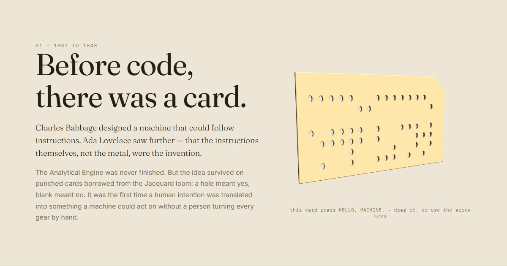

# BUILD — The Language of Machines

An interactive history of programming, told as the history of humans learning to talk to machines.

**Live:** https://ashen360.github.io/BUILD/



## The idea

One sentence runs through the whole site. The intro types `HELLO, MACHINE.`, and every chapter says it again in the medium of its era. A small **Message** strip in the corner shows the current form, and the last screen asks you to write your own.

| Chapter | Era | You… |
|---|---|---|
| 01 · Before Code | 1837–1843 | **drag** a 3D punched card whose holes spell `HELLO, MACHINE.` in ASCII |
| 02 · Machines Learn | 1943–1949 | **switch** eight valves to set one byte, and spell `H` |
| 03 · We Invent Languages | 1954–1970 | **scrub** a ladder of eight languages saying HELLO |
| 04 · The Personal Computer | 1977–1985 | **type** into a working mini-BASIC (`PRINT`, `LET`, `FOR…NEXT`, `LIST`, `RUN`) |
| 05 · The Web | 1989–1999 | **fly** through a 3D network of documents, servers and people |
| 06 · Software Everywhere | 2001–2015 | **scan** a dense grid of milestones |
| 07 · Language Turns Around | 2012–now | **tap** a token to see what comes next |
| — · Your Turn | next | **write** what you would teach the machine |

The page re-themes itself per era through one `data-era` attribute and CSS custom properties.

## Built with

Plain HTML, CSS and JavaScript. No framework and no build step. The only dependency is [Three.js r128](https://threejs.org/), loaded from cdnjs, for the punched card and the network.

- Animation loops pause off-screen through a shared `IntersectionObserver` helper (`js/core.js`).
- `prefers-reduced-motion` stops auto-rotation, glow, drift and smooth scrolling.
- Without WebGL, a 2D punched card takes the 3D one's place and the network explains why it's missing.
- Every interactive piece works from the keyboard: the card, ladder, valves, terminal, network and tokens.

## Run it locally

Any static server works:

```bash
python -m http.server 5178
```

Then open http://localhost:5178.

## Structure

```
index.html        markup for all chapters
css/base.css      era themes, type, shell, nav, Message strip
css/chapters.css  per-chapter layouts
js/core.js        shared helpers (reduced motion, WebGL check, on-screen gate)
js/message.js     the persistent HELLO strip
js/*.js           one file per chapter interaction
```
